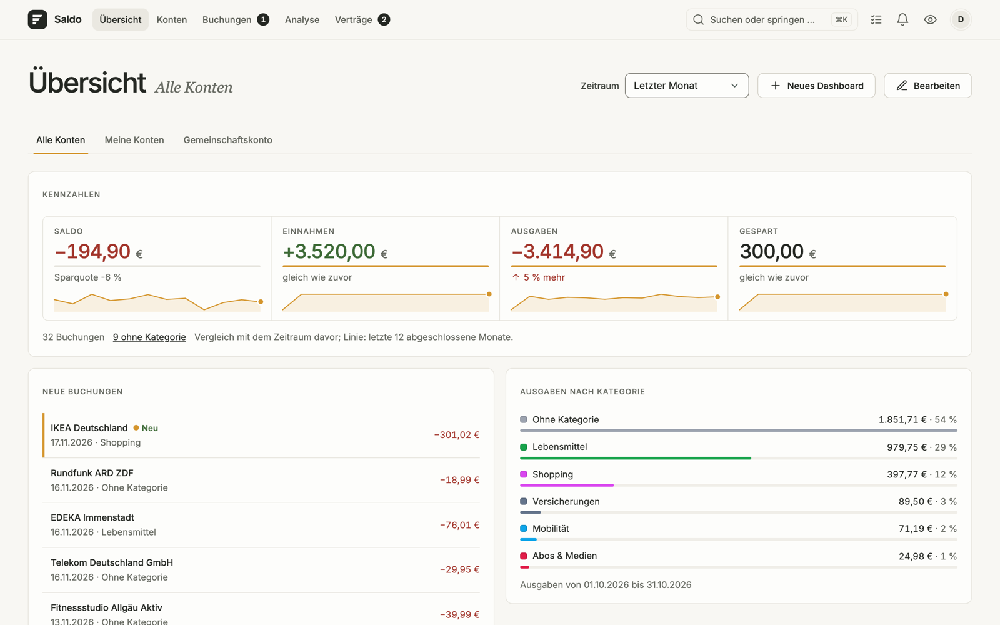
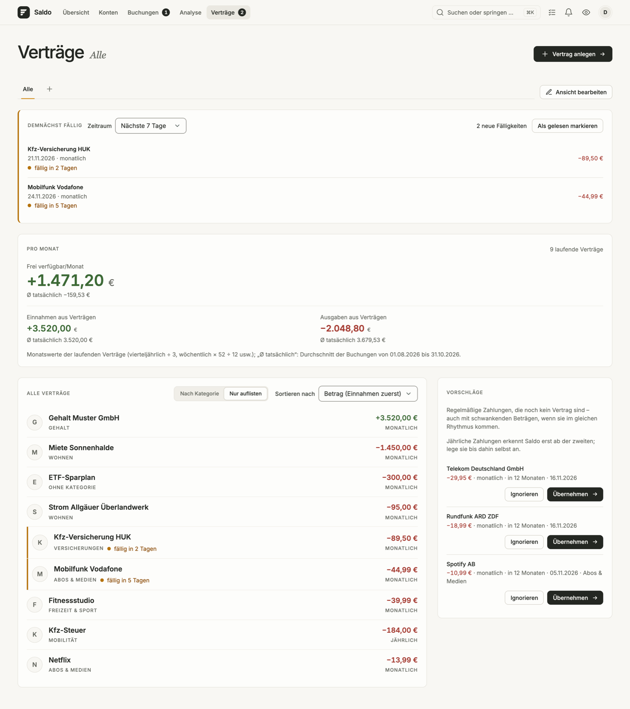
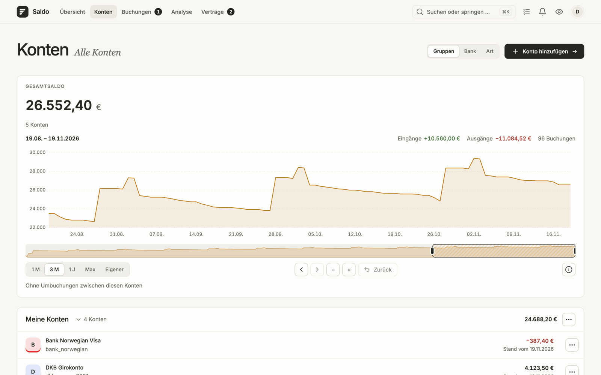
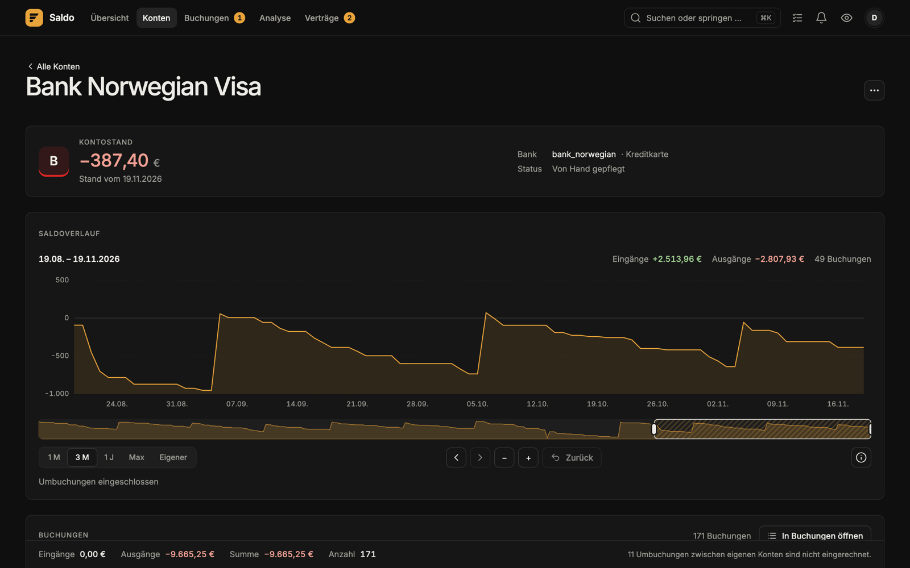
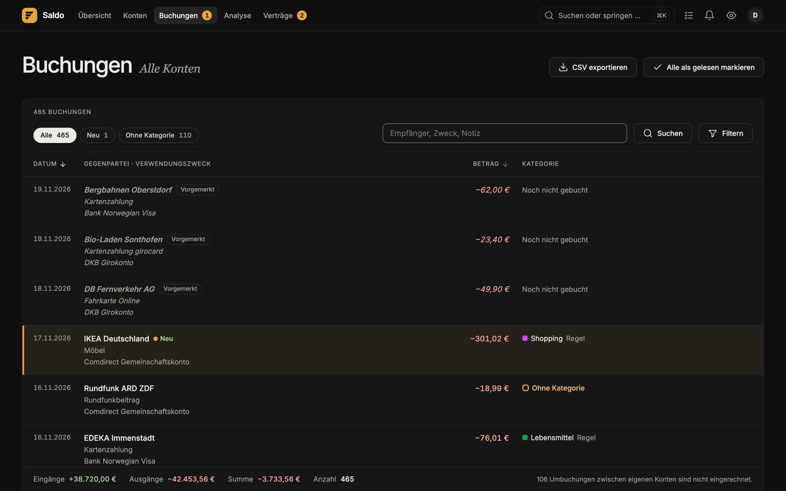
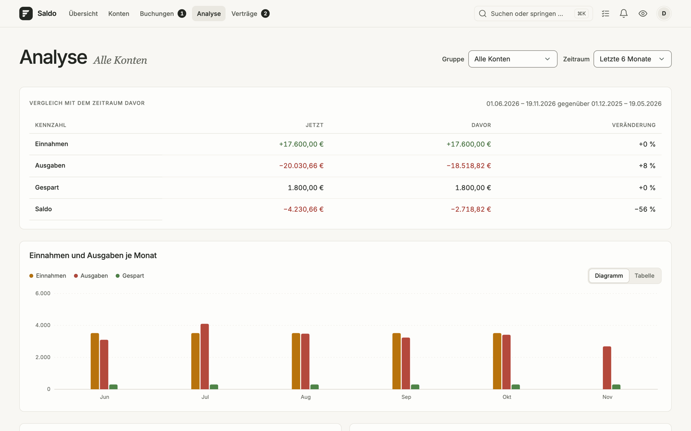
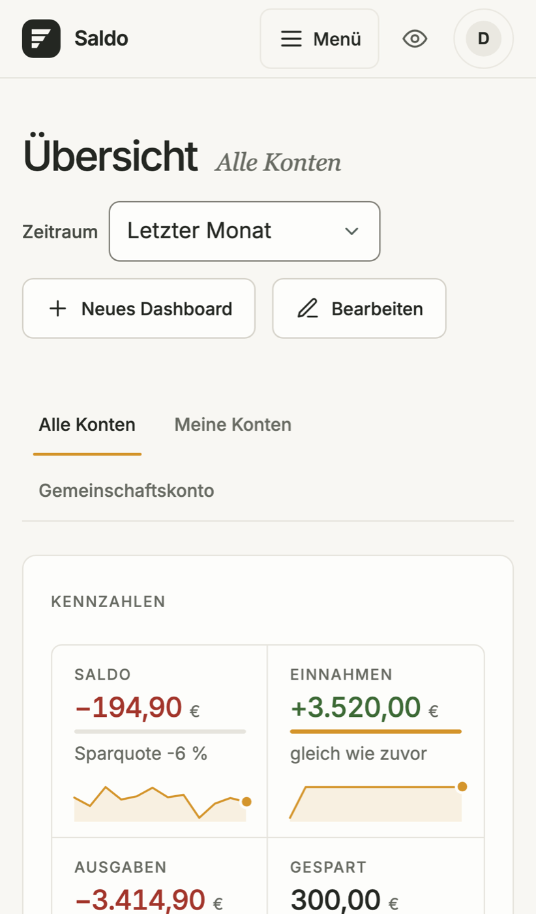
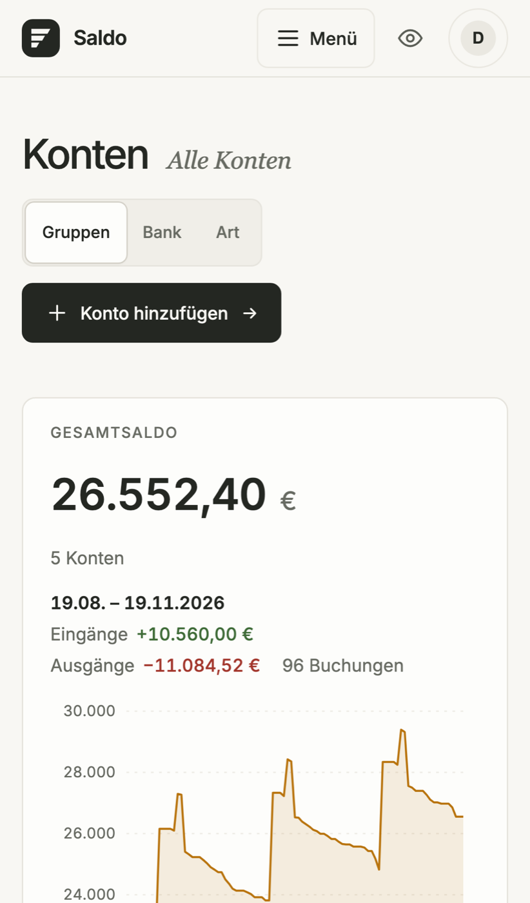
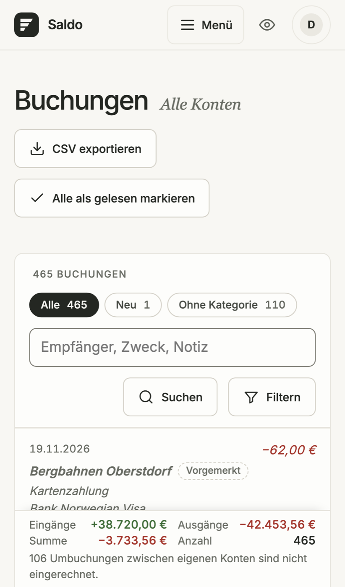
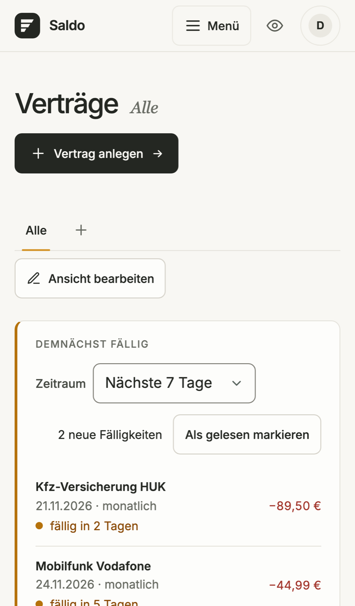

# Saldo

Selbst gehostetes Haushaltsbuch: Konten, Buchungen, Auswertungen und Dashboards für den ganzen Haushalt.
**Nur lesend** – Saldo löst nie Zahlungen aus. Läuft per Docker auf dem eigenen Server im Heimnetz.

> Saldo ist für das Heimnetz oder ein VPN gedacht. Nicht ins Internet freigeben.

## Vorschau

Beispieldaten im Standarddesign „Leinen“ (hell und dunkel), mit erfundenen Konten, Buchungen und Verträgen.

| Übersicht                                                                                                      | Verträge                                                                                                           |
| -------------------------------------------------------------------------------------------------------------- | ------------------------------------------------------------------------------------------------------------------ |
|  |  |
| **Konten**                                                                                                     | **Kontodetail**                                                                                                    |
|                                    |                              |
| **Buchungen**                                                                                                  | **Analyse**                                                                                                        |
|                          |                                    |

<p>
  
  
  
  
</p>

Weitere Ansichten (hell und dunkel) liegen in [`docs/screenshots`](docs/screenshots). Mit dem Augen-Symbol oben rechts
lassen sich alle Beträge ausblenden, etwa für Bildschirmfotos.

## Funktionen

- **Bankabruf** per **FinTS** (z. B. DKB, ING, Comdirect) und/oder **Enable Banking** (PSD2), je Verbindung wählbar; dazu
  optional inoffizielle Zugänge für **Trade Republic** und **givve** (experimentell), die ein Super-User bewusst einschaltet.
- **Depots**: Positionen (FinTS-Depotabruf, Trade Republic) mit Kurs, Wert, Anteil und Gewinn/Verlust; der Depotwert zählt
  im Gesamtsaldo, sein Tagesverlauf im Saldoverlauf.
  Zugangsdaten werden beim Speichern sofort geprüft.
- **Gruppen** frei anlegen (z. B. „Ich“, „Familie“, „Haus“); ein Konto kann in mehreren Gruppen sein.
  Überträge innerhalb einer Gruppe zählen nicht, an Konten außerhalb zählen sie als Ausgabe/Einnahme („Übertrag an …“).
- **Benutzer und Rollen**: Super-User (alles), Familien-Admins (Haushalt, Gruppen, Kategorien, Mitglieder) und Mitglieder
  (eigene Konten und Bankverbindungen). Konten sind Haushaltskonten (über Gruppen sichtbar) oder privat (nur Besitzer und
  Super-User, bis sie geteilt werden – mit Personen oder Gruppen). KI je Person freischaltbar.
- **Manuelle Konten** (Bargeld, Prepaid- und Gutscheinkarten wie Givve, Depots): Saldo mit Datum eintragen, Buchungen tippen
  oder als CSV importieren (Spaltenzuordnung mit Vorschau, doppelte Zeilen werden erkannt, bis 2 MB).
- **Dashboards** je Benutzer und Gruppe mit konfigurierbaren Karten; neue Buchungen mit „Neu“-Markierung. Jedes Dashboard
  hat einen Zeitraum (auch „Nächster Monat“ als Prognose aus Verträgen oder ein eigener Zeitraum), dem die Karten folgen,
  sofern sie keinen eigenen haben.
- **Verträge** (Einnahmen und Ausgaben wie Gehalt, Miete, Versicherungen, Abos): aus einer Buchung, aus erkannten
  regelmäßigen Zahlungen oder von Hand anlegen. Buchungen werden automatisch zugeordnet; Saldo zeigt die Summen pro Monat
  mit Überschuss/Puffer, was demnächst fällig ist, Preisänderungen und ausgebliebene Zahlungen (auch als Benachrichtigung).
- **Kategorien, Tags und Regeln** (Textregeln, nachträglich auf alle Buchungen angewendet), CSV-Export.
- **KI** (optional, eigener Schlüssel; Anbieter und Modell wählbar, Modelle werden live abgefragt):
  Kategorisierung, Spar-Analyse, Chat, der die nötigen Buchungen der gewählten Ansicht selbst abfragt und gewünschte
  Buchungen direkt in „Buchungen“ mit Filtern und Summen öffnet (der Chat bleibt daneben offen, Rückfragen verfeinern
  die Liste). Gespräche werden je Person privat gespeichert (Verlauf, Aufbewahrung unter „Persönlich → Daten“), Fragen
  lassen sich diktieren (Spracherkennung des Browsers). Verbrauch und Kosten werden protokolliert.
- **MCP-Server**: Claude Desktop/Code und andere KI-Programme können lesend auf die eigenen Gruppen zugreifen (Token je Benutzer).
- **Protokoll** für Super-User: Anmeldungen, KI-Anfragen, Bankabrufe, Änderungen und Exporte nachvollziehen (siehe unten).
- **Sicherung und Wiederherstellung** für Super-User: verschlüsselte Archive nach Zeitplan auf lokale Ordner, SFTP,
  FTP/FTPS, SMB, Backblaze B2, S3 oder WebDAV/Nextcloud, mit Aufbewahrung je Ziel, Download und geprüfter Wiederherstellung.
- **Sprachen**: Deutsch, Englisch, Französisch und Italienisch, je Benutzer unter „Persönliche Einstellungen → Darstellung“
  wählbar („Automatisch“ folgt der Browsersprache). Benachrichtigungen, E-Mails und KI-Antworten kommen in der Sprache des
  Benutzers. Der CSV-Export bleibt sprachunabhängig (deutsche Spaltennamen, festes Format), damit Auswertungen stabil bleiben.
- Farbthemen Leinen (Standard), Leinen Nacht (Leinen mit dunkler Kopfleiste), Tanne, Fjord, Holunder und Schiefer; hell/dunkel;
  einklappbare Navigation.

## Installation auf einem Linux-Server

```sh
git clone <repo> saldo && cd saldo
./install.sh --bind 127.0.0.1 --port 8010 --url https://192.168.1.10:8445
```

`install.sh` erzeugt `.env` (Modus 600) mit zufälligen Geheimnissen (`AUTH_SECRET`, `ENCRYPTION_KEY`, Datenbank- und
Super-User-Passwort), baut die Container und startet sie. Das erste Passwort steht einmalig in der Ausgabe und in `.env`.

Ohne `--bind` lauscht Saldo nur auf `127.0.0.1` – gedacht für einen Reverse Proxy mit HTTPS auf demselben Rechner (siehe
unten). Mit `--bind <IP>` antwortet Saldo direkt im Netz über unverschlüsseltes HTTP; das Skript warnt dann und nimmt nur
private Adressen (`10.0.0.0/8`, `172.16.0.0/12`, `192.168.0.0/16`, `100.64.0.0/10`, `fc00::/7`), öffentliche Adressen und
`0.0.0.0` nur mit `--allow-public`.

`APP_URL` ist die Adresse, unter der du Saldo im Browser öffnest. Davon abgeleitet ist die feste
**Rückleitungsadresse für Enable Banking**: `APP_URL/bank/callback`.

### HTTPS davor (empfohlen)

Saldo lauscht nur auf `BIND_ADDRESS:PORT` (Standard `127.0.0.1:8000`). Ein Reverse Proxy (nginx, Caddy) stellt HTTPS bereit
und setzt `X-Forwarded-For` auf die Adresse des Browsers (nicht anhängen: `$remote_addr`, nicht
`$proxy_add_x_forwarded_for`). Damit Saldo diesen Header glaubt, in `.env` `TRUSTED_PROXY` setzen:

- `off` (Standard): Saldo ignoriert `X-Forwarded-For`, weil jeder Client ihn mitschicken kann, und nimmt die Adresse der
  Verbindung. Hinter einem Proxy ist das die des Proxys; Anmeldedrosselung und Protokoll sehen dann alle unter einer Adresse.
- `on` (ein Proxy) oder die Zahl hintereinander geschalteter Proxys (`2` … `10`): der Eintrag, den der äußerste Proxy
  gesetzt hat. Nur, wenn der App-Port allein vom Proxy erreichbar ist (`BIND_ADDRESS=127.0.0.1`).
- Adressen oder CIDR-Bereiche der Proxys, z. B. `TRUSTED_PROXY=172.16.0.0/12` (Docker-Netze): der Header zählt nur bei
  Verbindungen von dort; Saldo nimmt den Eintrag ganz rechts, der nicht zu diesen Proxys gehört.

Die so ermittelte Adresse nutzen die Anmeldedrosselung, das Protokoll, die MCP-Drosselung und die PSU-Adresse für Banken.
Beispiel nginx (mit `TRUSTED_PROXY=on`):

```nginx
server {
    listen 8445 ssl;
    ssl_certificate     /etc/ssl/saldo/saldo.crt;
    ssl_certificate_key /etc/ssl/saldo/saldo.key;
    allow 192.168.0.0/16; deny all;
    client_max_body_size 2M;
    location / {
        proxy_pass http://127.0.0.1:8010;
        proxy_set_header Host $http_host;
        proxy_set_header X-Forwarded-For $remote_addr;
        proxy_set_header X-Forwarded-Proto $scheme;
        proxy_read_timeout 300s;
    }
}
```

Läuft auf demselben Server ein weiterer, weniger vertrauenswürdiger Webdienst unter derselben Adresse, Saldo besser unter
einem eigenen Hostnamen betreiben: Browser schicken Cookies an alle Ports eines Rechners.

## Bankverbindungen

Ein Super-User richtet unter **Einstellungen → Bankverbindungen** Enable Banking und/oder FinTS ein (unabhängig
voneinander). Verbunden wird danach auf der Seite **Konten** („Konto hinzufügen“ → „Bank verbinden“), von jeder Person
für ihre eigene Bank; sind mehrere Zugänge eingerichtet, wählt man ihn dabei. Saldo legt für jedes Konto des Zugangs ein
Konto an (oder verknüpft ein vorhandenes mit derselben IBAN); ein Konto, das schon über eine andere Verbindung kommt, bleibt
dort. Direkt nach dem Verbinden ruft Saldo die Buchungen einmal ab. Abrufen, Freigabe erneuern, „Bei ‚Konten abrufen‘
überspringen“ und Trennen stehen im Menü jedes Kontos und betreffen die ganze Verbindung. Den **automatischen Abruf** legt
ein Super-User einmal für alle Verbindungen fest (Uhrzeiten des Servers); Verbindungen, die nur manuell abgerufen werden,
bleiben dabei außen vor.

**Inoffizielle Zugänge** (Trade Republic; givve experimentell) sind aus, bis ein Super-User sie nach einem Warnhinweis
einschaltet: Sie verstoßen gegen die Nutzungsbedingungen des Anbieters bzw. sind dort nicht vorgesehen, können das Konto
sperren lassen und jederzeit aufhören zu funktionieren; Zugangsdaten und Sitzung werden verschlüsselt gespeichert. Saldo
liest dabei nur (Allowlist im Client). Ihre Verbindungen werden standardmäßig nur auf Anforderung abgerufen.

|               | FinTS                                                                      | Enable Banking                                                                             |
| ------------- | -------------------------------------------------------------------------- | ------------------------------------------------------------------------------------------ |
| Voraussetzung | FinTS-Produktregistrierung (kostenlos, bei der Deutschen Kreditwirtschaft) | eigene App im Enable-Banking-Control-Panel (Production, „eingeschränkt“ für eigene Konten) |
| Anmeldung     | Online-Banking-Login + PIN, Freigabe per TAN/App                           | Freigabe bei der Bank, gültig 90–180 Tage                                                  |
| Prüfung       | Beim Anlegen sofortiger Testabruf (PIN-Fehler zeigen sich direkt)          | App-ID und Schlüssel werden beim Speichern bei Enable Banking geprüft                      |

**Enable Banking einrichten**

1. Im Control Panel eine Production-App anlegen, Rückleitungsadresse = die in Saldo angezeigte (`APP_URL/bank/callback`).
2. Den heruntergeladenen `.pem`-Schlüssel und die App-ID in Saldo eintragen; Saldo prüft sie sofort.
3. Im Control Panel „Activate by linking accounts“ ausführen (Freigabe bei der eigenen Bank), dann in Saldo die Verbindung anlegen.
4. Eine „eingeschränkte“ App erreicht nur Konten, die im Control Panel verknüpft sind: Bevor ein Mitglied seine Bank
   verbindet, verknüpft der Super-User sie dort einmal über „Link accounts“. Sonst zeigt Saldo beim Anmelden einen Hinweis.

## Benutzer und Gruppen

- **Gruppen** (Einstellungen → Gruppen) bündeln Konten; ein Konto kann in mehreren Gruppen sein.
- **Benutzer** (Einstellungen → Benutzer): Super-User vergeben alle Rollen und „Darf KI nutzen“; Familien-Admins legen nur
  Mitglieder an, setzen deren Passwort zurück und weisen Gruppen zu.
- **Super-User**: Bankzugang (Enable-Banking-App bzw. FinTS-Produkt), SMTP, KI-Anbieter, Protokoll, alle Benutzer; sieht alle
  Konten, auch private.
- **Familien-Admin**: Haushaltskonten und -bankverbindungen, Gruppen, Kategorien, Tags, Regeln, Mitglieder.
- **Mitglied**: sieht die Konten seiner Gruppen, verbindet die eigene Bank und legt manuelle Konten an (privat), teilt sie mit
  Personen oder Gruppen und setzt Kategorien, Tags und Notizen.
- Beim Update werden bisherige Administratoren zu Super-Usern, Mitglieder bleiben Mitglieder, alle vorhandenen Konten und
  Bankverbindungen werden Haushaltskonten des ersten Super-Users (für niemanden ändert sich, was er sieht).

## MCP

Einstellungen → MCP zeigt die Adresse (`APP_URL/api/mcp`) und erzeugt Tokens. Beispiel Claude Code:

```sh
claude mcp add --transport http saldo https://192.168.1.10:8445/api/mcp --header "Authorization: Bearer <token>"
```

Alle Werkzeuge sind lesend und sehen genau, was der Token-Besitzer sieht. Der Chat in Saldo nutzt dieselben Werkzeuge,
fest auf die gewählte Ansicht begrenzt; nur über MCP (das eigene Programm des Token-Besitzers) kommen zusätzlich
Kontostände, Depotbestände (`list_holdings`) und Notizen. Bei selbst signiertem Zertifikat dem MCP-Programm das
Zertifikat bekannt machen (z. B. `NODE_EXTRA_CA_CERTS`).

Ein Token gilt ein Jahr (vorher erstellte Tokens bis zum Widerruf). Ändert jemand sein Passwort oder setzt ein Admin es
zurück, werden alle Tokens und Push-Abonnements dieser Person gelöscht; ein Aufruf darf höchstens 20 JSON-RPC-Nachrichten
bündeln.

## Protokoll

Einstellungen → Protokoll (nur Super-User) zeigt, wer wann was getan hat – mit Filtern nach Benutzer, Bereich,
Ergebnis und Zeitraum, Suche und CSV-Export. Alle anderen sehen das Protokoll nicht; der Server lehnt ihre Anfragen ab.

Aufgezeichnet werden Zeitpunkt, Benutzer, Aktion, Ergebnis (erfolgreich/fehlgeschlagen), IP-Adresse (die der Verbindung,
hinter einem Proxy mit `TRUSTED_PROXY` die vom Proxy gemeldete, siehe oben) und gekürzter User-Agent:

- **Anmeldung**: Anmelden (auch fehlgeschlagen, mit dem eingegebenen Benutzernamen), Abmelden, Passwort ändern,
  Passwort durch einen Super-User oder Familien-Admin zurücksetzen, Sitzungen beenden.
- **Benutzer**: anlegen, ändern (Rolle, Gruppenzugriff, „Darf KI nutzen“), löschen.
- **Konten**: anlegen, löschen, Freigabe (mit wem geteilt), CSV-Import (Zahl der neuen Buchungen).
- **KI**: jede Anfrage (Kategorisieren, Neu kategorisieren, automatisches Kategorisieren nach dem Abruf, Analyse,
  Chatnachricht, Vorschlag) mit Anbieter, Modell, Tokens und geschätzten Kosten; beim Chat jeder Modellaufruf einzeln,
  mit den Namen der abgefragten Werkzeuge (ohne Suchbegriffe oder Ergebnisse); gelöschte und abgelaufene Chats nur als
  Anzahl.
- **Bank**: Bankverbindung anlegen, ändern (nur welche Felder), freigeben, erneuern, löschen; Abruf gestartet und beendet
  (manuell oder geplant, Zahl neuer Buchungen); Änderungen der Bankeinstellungen.
- **Einstellungen**: KI-Anbieter anlegen, ändern, aktivieren, löschen; SMTP-Einstellungen, Test-E-Mail; MCP-Token
  erstellen und widerrufen (nur der Name).
- **Sicherung**: Ziele anlegen, ändern, testen, löschen; Zeitplan und Passphrase ändern (nie die Passphrase selbst);
  jeder Lauf (Anlass, Datei, Größe, fehlgeschlagene Ziele); Downloads; Wiederherstellungen.
- **Export**: CSV-Export der Buchungen und des Protokolls, MCP-Abfragen (nur der Werkzeugname und der Token-Besitzer).

Nie protokolliert werden Passwörter, PINs, TANs, Schlüssel, Tokens, Bank-Codes, Chat- und Analyseinhalte, Suchbegriffe
von MCP-Abfragen und Buchungsdaten. Einträge werden nach `AUDIT_RETENTION_DAYS` Tagen (Standard 365) beim täglichen Lauf
um 8 Uhr gelöscht. Wird ein Benutzer gelöscht, bleiben seine Einträge mit dem Benutzernamen erhalten.

## Sicherung und Wiederherstellung

Einstellungen → Sicherung (nur Super-User, nie beim Ansehen als andere Person) sichert die ganze Datenbank – Buchungen,
Verträge mit ihren Dokumenten, Profilbilder, alle Einstellungen – als verschlüsselte `.saldo-backup`-Datei und kopiert
sie auf ein oder mehrere Ziele. Sitzungen werden nicht mitgesichert: Nach einer Wiederherstellung melden sich alle neu an.

**Ziele** (beliebig viele, jedes mit eigenem „Aufbewahren: die letzten N“):

| Art              | Angaben                                                                                                       |
| ---------------- | ------------------------------------------------------------------------------------------------------------- |
| Lokaler Ordner   | Unterordner von `./backups` auf dem Server (im Container `/backups`)                                          |
| SFTP             | Server, Port, Benutzer, Passwort oder privater Schlüssel, Ordner, optional Hostschlüssel (`ssh-keyscan host`) |
| FTP/FTPS         | Server, Port, Benutzer, Passwort, explizites/implizites TLS, Zertifikatsprüfung abschaltbar                   |
| SMB              | Server, Port, Benutzer, Passwort, Domäne, Freigabe, Ordner                                                    |
| Backblaze B2     | Key-ID, Application Key, Bucket, Ordner                                                                       |
| S3-kompatibel    | Endpunkt, Region, Access Key, Secret Key, Bucket, Ordner, Pfad-Adressierung (MinIO)                           |
| WebDAV/Nextcloud | Adresse (Nextcloud: `https://…/remote.php/dav/files/BENUTZER`), Benutzer, Passwort, Ordner                    |

Passwörter und Schlüssel werden mit `ENCRYPTION_KEY` verschlüsselt gespeichert und nie wieder angezeigt („Gespeichert“;
neu eingeben ersetzt sie). Ändert sich außer dem Ordner irgendeine Einstellung – Server, Benutzer, TLS-Modus,
Zertifikatsprüfung, Hostschlüssel, Endpunkt, Anbieter –, müssen sie neu eingegeben werden. Beim Speichern und mit
„Verbindung testen“ schreibt und löscht Saldo eine kleine Testdatei.

**Zeitplan**: aus, täglich, wöchentlich (Wochentag) oder monatlich (Tag 1–28 oder letzter Tag) zur gewählten Uhrzeit in der
Zeitzone des Servers (`TZ` in `.env`, auf der Seite angezeigt), auf die gewählten Ziele. „Jetzt sichern“ startet sofort.
Jede Sicherung läuft als Aufgabe (mit Fortschritt unter „Aufgaben“), immer nur eine zugleich; eine verpasste Sicherung
(Server aus) holt Saldo beim nächsten Start nach. Danach löscht Saldo auf jedem Ziel ältere Archive über die Aufbewahrung
hinaus – ausschließlich Dateien, die genau dem Namensmuster `saldo-JJJJ-MM-TTTHH-MM-SSZ.saldo-backup` (UTC) entsprechen;
fremde Dateien und die Sicherungen vor einer Wiederherstellung (`…-pre-restore.saldo-backup`) bleiben liegen. Der Verlauf
zeigt die letzten Läufe (Zeit, Ziele, Größe, Dauer, Ergebnis), „Archive“ die Dateien je Ziel mit Download.
Benachrichtigungen: „Sicherung fehlgeschlagen“ ist für Super-User von Anfang an eingeschaltet, „Sicherung erstellt“
nicht (Persönliche Einstellungen → Benachrichtigungen). Zielverwaltung, Zeitplan, Passphrase, Läufe, Downloads und
Wiederherstellungen stehen im Protokoll (Bereich „Sicherung“).

**Passphrase**: Archive werden mit einer eigenen Passphrase (mindestens 12 Zeichen) verschlüsselt, nicht mit dem
Serverschlüssel. Saldo speichert sie verschlüsselt, damit geplante Sicherungen laufen, und zeigt sie nie wieder an.
**Ohne diese Passphrase lässt sich keine Sicherung wiederherstellen.** Bewahre sie getrennt vom Server auf (Passwortmanager).
Eine neue Passphrase gilt nur für künftige Archive; ältere brauchen weiter die alte.

**Wiederherstellen** (Einstellungen → Sicherung): ein Archiv unter „Archive“ wählen oder eine Datei hochladen (bis 2 GB)
→ Passphrase eingeben → Saldo entschlüsselt und prüft das ganze Archiv (Format, Prüfsummen, Datenbankstand) und zeigt
Datum und Inhalt → „Wiederherstellen …“ → zur Bestätigung `WIEDERHERSTELLEN` eingeben. Dann:

1. Sicherung des aktuellen Stands in `./backups` (`…-pre-restore.saldo-backup`, mit der Sicherungs-Passphrase oder, wenn
   noch keine festgelegt ist, mit der des Archivs).
2. Einspielen in eine neue, leere Datenbank; Zeilenzahlen gegen das Archiv prüfen. Ein Archiv gilt dabei als
   nicht vertrauenswürdig: Eingespielt werden nur Tabellen, ihre Daten, Sequenzen, Standardwerte, Indizes und
   Constraints in den Schemas `public` und `drizzle` (Liste aus `pg_restore --list`, jeder andere Eintrag wie
   Funktionen, Trigger, Erweiterungen oder fremde Schemas lehnt das Archiv ab), ohne Kommentare und Rechte, und zwar von
   einer eigens angelegten Rolle ohne Superuser-Rechte, der nur die neue Datenbank gehört. Danach prüft Saldo die neue
   Datenbank auf Funktionen, Trigger, Regeln, Sichten, Richtlinien, Datenbankeinstellungen und Ähnliches, übernimmt den
   Besitz und löscht die Rolle wieder.
3. Migrationen ausführen (Archive älterer Versionen werden aktualisiert; Archive einer **neueren** Version lehnt Saldo ab).
4. Stammt das Archiv von einer Instanz mit anderem `ENCRYPTION_KEY`, werden Bank-PINs, Schlüssel und Passwörter auf den
   Schlüssel dieses Servers umgeschlüsselt (der alte Schlüssel steht verschlüsselt im Archiv).
5. Beide Datenbanken werden in einer Transaktion umbenannt: die neue wird `saldo`, die bisherige bleibt als
   `saldo_previous` bis zur nächsten Wiederherstellung liegen. Die App verbindet sich neu, alle melden sich neu an.

Schlägt ein Schritt fehl, bleiben die bisherigen Daten unverändert (die neue Datenbank wird verworfen). Der
Datenbankbenutzer braucht dafür das Recht, Datenbanken anzulegen und umzubenennen (in `compose.yml` ist er Superuser der
Datenbank; bei einer eigenen PostgreSQL-Instanz `CREATEDB` und Besitzer der Saldo-Datenbank).

**Notfall ohne Oberfläche** – im Container, mit einer Datei in `./backups` (Passphrase wird verdeckt abgefragt oder aus
`SALDO_BACKUP_PASSPHRASE` gelesen):

```sh
docker compose exec -w /app/apps/web app bun scripts/restore.ts --check /backups/saldo-….saldo-backup   # nur prüfen
docker compose exec -w /app/apps/web app bun scripts/restore.ts /backups/saldo-….saldo-backup           # wiederherstellen
# Läuft die App nicht:
docker compose run --rm --entrypoint bun -w /app/apps/web app scripts/restore.ts /backups/saldo-….saldo-backup
```

Die Wiederherstellung läuft dabei genau wie in der Oberfläche (Bestätigung mit `RESTORE`). Mit
`--extract <datei> <leerer-ordner>` schreibt das Skript stattdessen `manifest.json` und den reinen `database.dump`
(pg_dump-Custom-Format) für ein `pg_restore` von Hand; `manifest.json` enthält den `ENCRYPTION_KEY` der Quelle.

**Wo was läuft**: `pg_dump`/`pg_restore` (Debian-Paket `postgresql-client-17`, passend zum PostgreSQL-17-Server) und
rclone (feste Version, im Containerfile per SHA-256 geprüft) laufen im App-Container. Er bleibt schreibgeschützt und ohne
Capabilities; geschrieben wird nur nach `/backups` (`./backups`, als `BACKUP_UID`/`BACKUP_GID`) und ins tmpfs `/tmp`. Die
Programme werden ohne Shell mit Argumentlisten gestartet und sehen nur die nötigen Umgebungsvariablen (nie `AUTH_SECRET`,
`ENCRYPTION_KEY` oder `DATABASE_URL`). rclone bekommt sein Ziel nur über `RCLONE_CONFIG_SALDO_*`-Variablen (Passwörter
„obscured“, keine Konfigurationsdatei; nur eine SFTP-Hostschlüsselliste landet kurz in `/tmp`), mit Zeitlimits und
`--low-level-retries=3`. Zwischendateien unter `./backups/.saldo-tmp` sind immer verschlüsselt.

**Der nächtliche Dump** des Dienstes `backup` läuft unverändert weiter (`./backups/saldo-JJJJ-MM-TT.dump`, unverschlüsselt,
`BACKUP_KEEP_DAYS` Tage). Sobald verschlüsselte Sicherungen auf ein externes Ziel laufen, kann er mit
`docker compose stop backup` (bzw. aus `compose.yml` entfernt) abgeschaltet werden. Wiederherstellen eines solchen Dumps:

```sh
docker compose stop app
docker compose exec -T db pg_restore --clean --if-exists -U saldo -d saldo < backups/saldo-JJJJ-MM-TT.dump
docker compose start app
```

Für diese Dumps `.env` mitsichern – ohne `ENCRYPTION_KEY` sind gespeicherte Bank- und KI-Schlüssel nicht mehr lesbar
(`.saldo-backup`-Archive bringen ihn mit).

### Format von `.saldo-backup`

Ein Tar-Strom aus `manifest.json` und `database.dump` (pg_dump, Custom-Format), gzip-komprimiert und als Ganzes
verschlüsselt. Datei = 56 Byte Kopf, dann Blöcke:

| Byte  | Inhalt                                                                     |
| ----- | -------------------------------------------------------------------------- |
| 0–7   | `SALDOBAK`                                                                 |
| 8     | Containerversion (1)                                                       |
| 9     | KDF (1 = scrypt)                                                           |
| 10–12 | log2 N, r, p (Standard 17, 8, 1 = 128 MiB)                                 |
| 13–28 | Salt (zufällig)                                                            |
| 29–35 | Nonce-Präfix (zufällig)                                                    |
| 36–39 | Blockgröße (uint32 BE, Standard 64 KiB)                                    |
| 40–55 | Schlüsselprüfung: erste 16 Byte von HMAC-SHA-256(MAC-Schlüssel, Byte 0–39) |

scrypt(Passphrase in NFC, Salt) ergibt 64 Byte: AES-Schlüssel und MAC-Schlüssel. Jeder Block ist AES-256-GCM mit dem
Kopf als zusätzlichen Daten und der Nonce Präfix ‖ Blockzähler (uint32 BE) ‖ Schlussmarke (1 Byte, 1 nur im letzten
Block), danach das 16-Byte-Tag. So fallen geänderte, vertauschte, abgeschnittene oder verlängerte Dateien auf; eine
falsche Passphrase scheitert schon an der Schlüsselprüfung. Beim Lesen begrenzt Saldo die KDF-Parameter (höchstens
256 MiB Speicher).

`manifest.json`: Formatversion, Zeitpunkt, Saldo-Version und Git-Commit (Build-Argument `GIT_SHA`), PostgreSQL- und
pg_dump-Version, die angewendeten Migrationen (Anzahl, Hash, Liste), Zeilenzahl je Tabelle, nicht mitgesicherte
Tabellendaten (`session`, `verification`, `impersonations`), der `ENCRYPTION_KEY` der Quelle und Größe und SHA-256 von
`database.dump`.

## Sicherheit

- Nur lesend; keine Zahlungsfunktionen.
- Anmeldung über better-auth (Benutzername + Passwort, mind. 12 Zeichen, Drosselung von Fehlversuchen), keine Selbstregistrierung.
- CSRF-Schutz, Sicherheitsheader, Größenlimit für Anfragen; der App-Container läuft schreibgeschützt ohne Linux-Capabilities.
- PINs, Bankzugänge, der Enable-Banking-Schlüssel, KI-Schlüssel, Zugangsdaten der Sicherungsziele und die
  Sicherungs-Passphrase liegen AES-256-GCM-verschlüsselt in der Datenbank und werden nie an die Oberfläche zurückgegeben.
- Die KI bekommt nur, was nötig ist: Empfängernamen, Richtung, typische Beträge und Monatssummen. Im Chat fragt sie über
  lesende Werkzeuge selbst ab, was sie braucht – Buchungen (Datum, Empfänger, Zweck, Betrag, Kategorie, Tags), Summen
  und die Konten (Name, Art), nur aus der gewählten Ansicht, höchstens 6 Runden und begrenzte Datenmenge je Antwort.
  Modelle ohne Werkzeuge bekommen stattdessen den Überblick des laufenden Monats und die Buchungen der letzten 30 Tage.
  IBANs, Notizen, Kontostände und Depotwerte gehen nie an die KI in Saldo.
- Gespeicherte Chats sieht nur ihr Besitzer, auch Super-User nicht; beim Ansehen als andere Person wird nichts gespeichert
  oder angezeigt. Sie werden nach der gewählten Frist (Standard 90 Tage) beim täglichen Lauf gelöscht. Beim Diktieren
  verarbeitet der Browser-Hersteller den Ton auf seinen Servern (Chrome: Google, Safari: Apple); Saldo speichert keine
  Aufnahmen.

## Entwicklung

Bun-Monorepo: `apps/web` (TanStack Start, Drizzle, better-auth), `packages/core` (Klassifizierung, Statistik),
`packages/banking` (Enable Banking, FinTS). Konventionen: [AGENTS.md](AGENTS.md).

```sh
bun install
docker run -d --name saldo-test-db -e POSTGRES_USER=finanzen -e POSTGRES_PASSWORD=finanzen-test \
  -e POSTGRES_DB=finanzen_test -p 127.0.0.1:54329:5432 postgres:17-alpine
bun run test        # Vitest gegen die Test-Datenbank
bun run lint && bun run typecheck && bun run build
```

Die Sicherungstests (`modules/backup/backup.test.ts`, `e2e/sicherung.spec.ts`) brauchen `pg_dump` und `pg_restore`
(Version 17) sowie `rclone` im `PATH`; ohne sie überspringt Vitest sie. rclone stellt für die Tests selbst WebDAV- und
SFTP-Server auf 127.0.0.1 bereit, es gibt keine Verbindungen nach außen.

## Lizenz

Saldo ist freie Software unter der [GNU Affero General Public License](LICENSE), Version 3 oder (nach deiner Wahl) jeder späteren Version (AGPL-3.0-or-later). Wer Saldo
verändert und anderen – auch nur als Web-Dienst – zur Verfügung stellt, muss ihnen den Quellcode der veränderten
Fassung anbieten. Wie man mitarbeitet, steht in [`CONTRIBUTING.md`](CONTRIBUTING.md).
